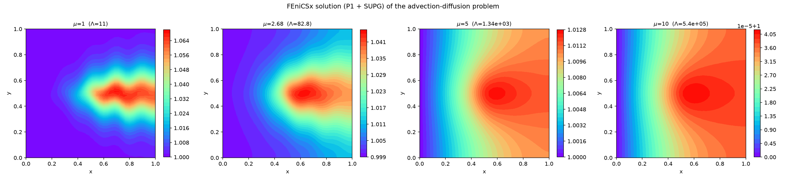
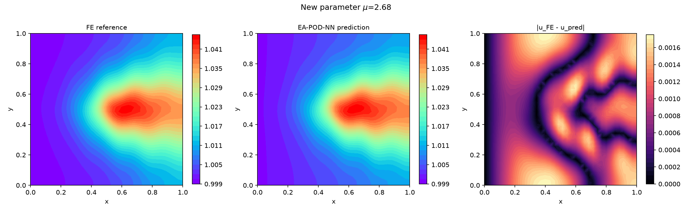

# EA-POD-NN: Error-Aware POD–Neural Network reduced-order modelling

Python implementation of the **EA-POD-NN** method, a non-intrusive reduced-order model that combines
Proper Orthogonal Decomposition (POD) with deep neural networks, developed during my PhD thesis at the
Institut de Mathématiques de Toulouse (INSA Toulouse).

The method was applied to the 2D shallow water equations to simulate floodplain dynamics of the Aude
river (France), using [DassFlow](https://www.math.univ-toulouse.fr/DassFlow/) as the high-fidelity solver.

> **Paper**: M. Allabou, R. Bouclier, P.-A. Garambois, J. Monnier.
> *Reduction of the Shallow Water System by an Error Aware POD-Neural Network Method: Application to
> Floodplain Dynamics.* Computer Methods in Applied Mechanics and Engineering, 2024.
> Open-access version: [hal-04391872](https://hal.inrae.fr/hal-04391872)

## The method in short

**Offline stage** (done once):

1. Run the high-fidelity (HF) solver for a set of parameters μ and collect the solutions (snapshots).
2. Compute a POD basis **B_rb** with a limited number of modes.
3. Compute a second POD basis **B_er** of the projection error `S − B_rb B_rbᵀ S`.
4. Train two neural networks mapping (μ, t) to the coefficients on **B_rb** and on **B_er**.

**Online stage** (real time, no HF solver needed):

```
u(μ, t) ≈ B_rb · NN_rb(μ, t) + B_er · NN_er(μ, t)
```

Taking the POD projection error into account gives better accuracy while keeping few POD modes, hence
small networks and a small training set — even for convection-dominated flows.

## Repository structure

```
├── main.py                    # Aude test case with DassFlow: offline / online
├── requirements.txt
├── ea_pod_nn/
│   ├── pod.py                 # POD bases B_rb and B_er
│   ├── offline.py             # offline stage: bases + training of the two networks
│   ├── online.py              # online stage: fast prediction
│   ├── postprocessing.py      # error analysis and plots
│   ├── hydrographs.py         # inflow hydrographs and parameter space (Aude case)
│   └── solvers/
│       ├── base.py            # HFSolver: common interface for any HF solver
│       ├── dassflow.py        # DassFlow2D implementation
│       └── template.py        # template to plug another software
├── examples/
│   ├── toy_solver_demo.py     # full pipeline with an analytical solver (no DassFlow needed)
│   └── fenicsx_solver_demo.py # full pipeline with a FEniCSx finite element solver
└── docs/figures/              # figures shown in this README
```

## Installation

```bash
git clone https://github.com/MustaphaAllabou/The-EA-POD-NN-method.git
cd The-EA-POD-NN-method
python3 -m venv .venv
source .venv/bin/activate
pip install -r requirements.txt
```

The Aude test case additionally requires DassFlow2D and its Python wrapper `dassflow2d`.

The finite element example requires [FEniCSx](https://fenicsproject.org/) (dolfinx), e.g. with conda:

```bash
conda create -n fenicsx -c conda-forge fenics-dolfinx mpich
```

## Quick start

Run the whole method in a few seconds on an analytical problem:

```bash
python examples/toy_solver_demo.py
```

Finite element test case with FEniCSx (see [below](#finite-element-test-case-advection-diffusion-with-fenicsx)):

```bash
python examples/fenicsx_solver_demo.py solver   # test of the FE solver only
python examples/fenicsx_solver_demo.py          # full pipeline (Keras)
python examples/fenicsx_solver_demo.py torch    # full pipeline (PyTorch)
```

Aude test case (set the DassFlow paths at the top of `main.py` first):

```bash
python main.py offline   # HF simulations, POD bases, training
python main.py online    # prediction and comparison with a HF reference
```

Results are written in `results/` (Aude case) and `results_toy/` (examples).
Simulations are cached: delete the corresponding `snapshots_*` folder after changing a solver.

## Finite element test case: advection-diffusion with FEniCSx

`examples/fenicsx_solver_demo.py` applies EA-POD-NN to the steady, convection-dominated problem

```
-div(Λ(μ) ∇u) + w · ∇u = f   in (0,1)²,   u = 1 on {x = 0},   homogeneous Neumann elsewhere
Λ(μ) = exp(1.2 (μ + 1)),  μ ∈ [1, 10],   w = 10³ (1 + |cos 2πx|, sin(2πx/0.2))
f(x, y) = 10³ exp(-(|x − 0.5| + |y − 0.5|) / 0.1)
```

discretized with P1 finite elements and SUPG stabilisation on a 35×35 mesh (40 snapshots).
The snapshots store the homogeneous part `u − 1`, so the Dirichlet condition is exactly satisfied by the prediction.



EA-POD-NN prediction vs FE reference for a new parameter μ = 2.68:



## Using another simulation software

The method only needs snapshots, so any solver can be used. Subclass `HFSolver` and implement one method:

```python
from ea_pod_nn import HFSolver

class MySolver(HFSolver):
    variables = ("h", "u", "v")

    def run(self, mu, run_id, worker_id=0):
        # launch your simulation for the parameters mu, then return
        # times: (n_t,) and fields: (n_vars * n_nodes, n_t)
        return times, fields
```

Parallel runs, caching of the simulations and construction of the training data are handled by
`HFSolver.compute_snapshots`. See `ea_pod_nn/solvers/template.py`.

## Citation

If you use this code, please cite:

```bibtex
@article{allabou2024eapodnn,
  title   = {Reduction of the Shallow Water System by an Error Aware POD-Neural Network Method:
             Application to Floodplain Dynamics},
  author  = {Allabou, Mustapha and Bouclier, Robin and Garambois, Pierre-Andr{\'e} and Monnier, J{\'e}r{\^o}me},
  journal = {Computer Methods in Applied Mechanics and Engineering},
  year    = {2024},
  note    = {HAL: hal-04391872}
}
```

## Contact

Mustapha Allabou — Institut de Mathématiques de Toulouse, INSA Toulouse
